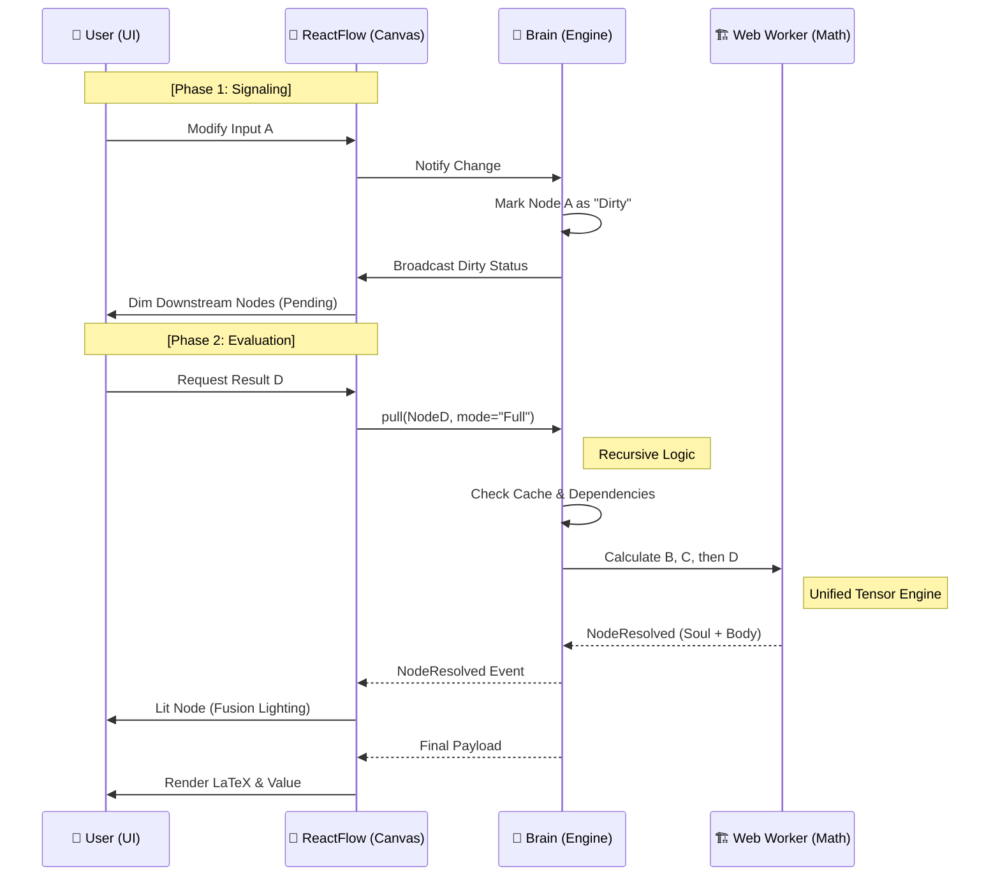

# ⚙️ Calctopus Engine Specification (The Bible)

This document serves as the absolute technical authority for the Calctopus calculation engine.

## 🏁 The Verdict & Core Principle
**Hybrid Pull Engine (Push Signal, Pull Data)**
- **Core Principle:** "Push bits (status), Pull bytes (payload)".
- **Reactivity:** Handled by "Dirty" signals propagating downstream.
- **Efficiency:** Handled by lazy recursive "Pull" requests from terminal nodes.

---

## �️ Core Dependencies (技術基石)
為了實現上述原則，引擎必須集成以下核心庫：
- **MathJS (BigNumber)**：數值運算、矩陣處理、單位換算的唯一入口。
- **nerdamer**：代數方程求解與符號化簡的核心工具。
- **tex-math-parser**：負責 LaTeX 到 MathJS AST 的逆向轉換。

---

## �🗺️ Master Architecture & Data Flow

---

## 🏗️ 核心規定 (Core Implementation Bible)

### 1. 引擎運作機制 (The Law of Flow)
- **Hybrid 優先**：嚴禁使用純 Push。必須使用 `Push Dirty Signal, Pull Payload`。
- **雙軌傳導 (Dual-Track Payload)**：
    - **魂 (Soul/AST)**：用於 LaTeX 顯示與符號運算。
    - **身 (Body/Value)**：用於數值運算並緩存。
- **按需計算 (Selective Processing)**：這是 Pull 模型的核心優化。
    - **邏輯**：不同的 Result 節點可以有不同的拉取需求（如：「我只要結果數字」或「我要全量公式」）。
    - **優化**：若下游所有的節點均只請求「Body/Value」，引擎在 Pull 過程中會**自動跳過** AST 的拼接與運算，確保資源不浪費在用戶不需要的東西上。
- **單位一致性律 (SI-First Law)**：
    - **內部計算**：引擎在計算（Body 軌）前，強制將所有輸入單位轉換為 SI 標準單位（Metric Standard）。
    - **顯示優先**：輸出顯示單位由用戶在 Result 節點設定，或根據輸入權重自動推導。
    - **符號保留**：Soul (AST) 軌道必須保留原始輸入的單位訊息，確保 LaTeX 輸出的原始性。
- **緩存填充律**：任何 Pull 請求在計算發生時，必須產出並緩存對應請求的 `NodePayload`。

### 2. UI-引擎同步律 (Sync Laws)
- **視覺即事實**：React Flow 的 `edges` 數組是連線的唯一依據，引擎必須直接監聽其變化。
- **原子性連線**：一根線的建立 (`onConnect`) 必須同步觸發引擎註冊。若引擎驗證失敗（如導致循環），畫布必須立刻撤回連線。

### 3. 連線處理生命週期 (Lifecycle)
1. **預檢**：檢查循環依賴與類型衝突。
2. **註冊**：在引擎依賴表中建立 Link。
3. **確認**：畫布顯示線路。
4. **拉取**：執行遞歸 `pull()` 完成數據閉環。

### 4. 規模無關的統一運算 (Scale-Agnostic Logic)
- **核心哲學**：一套管線通吃標量與矩陣。1 個數字被視為 $1 \times 1$ 的張量。
- **絕對精度 (The BigNumber Law)**：預設強制使用 MathJS BigNumber 處理所有科學運算，確保 `0.1 + 0.2` 的絕對精準。
- **性能擴展**：當數據達到矩陣量級時，引擎底層自動使用 TypedArrays (Float64) 加速，但對外接口與邏輯保持完全一致。

### 5. 零拷貝與融合式進度 (Efficiency & UX)
- **方案 A：Worker 池 (Worker Pool) - 大腦調度模型**：
    - **大腦主控 (Orchestrator)**：引擎主線程（Brain）負責維護全局拓撲、依賴層級與變量作用域。
    - **任務分裝 (Task Isolation)**：大腦將「原料已就緒」（即上游依賴已算完）的節點打包成獨立任務塊發射給 Worker。Worker 內部不執行任何跨節點的 Pull，僅作為純粹的「計算機器」。
    - **並行加速**：利用 `navigator.hardwareConcurrency` 維護核心池，將獨立分枝或同層級節點分配給空閒 Worker 並行執行。
    - **零等待機制**：Worker 永遠不進入「等待上游」的狀態。若數據未就緒，任務根本不會被發射，從而消除執行緒空轉（Execution Bubbles）。
    - **錯誤回退與監控**：Worker 計算失敗須立刻回報大腦；大腦具備超時監聽機制，確保系統不被死鎖。
    - **傳輸優化**：利用 `Transferable Objects` 協議傳輸大數據（如矩陣），確保主線程調度零開銷。
- **融合式進度 (Fusion Progress)**：
    - **NodeResolved**：當一個節點算完時，標記 `isDirty = false` 並向 UI 發送事件。
    - **視覺反饋**：UI 根據事件流，讓節點按計算順序點亮（類似 Fusion 渲染感），讓用戶看清數據流向。

### 6. 變量作用域與引用計數 (Scoping & GC)
- **變量唯一性**：同一個作用域內禁止同名變量。導入外部公式時執行 **「方案 B」**（自動合併同名變量，單一事實來源）。
- **引用計數回收 (Registry GC)**：
    - 引擎追蹤每個變量名的使用次數。
    - **自動遺忘**：當畫布上所有同名節點被刪除（計數歸零）後，該變量名正式從註冊表中釋放，確保內存與邏輯絕對清潔。

### 7. 持久化與絕對還原 (Persistence)
- **存檔格式**：採用 **JSON + LZ-String 壓縮**。
- **還原邏輯**：該字符串包含了宇宙的所有元數據（坐標、樣式、邏輯拓撲），可 100% 復活畫布。LaTeX 僅作為顯示與 Phase 3 的逆向骨架生成工具。
- **Undo 邊界**：
    - Undo 只記錄用戶的手動操作（修改輸入、重連線路、移動位置、重命名等）。
    - **API 實時優先**：API 數據節點視為「未來導向」的模板，Undo 操作不會快照 API 的歷史數據。Undo 後，引擎僅還原邏輯結構並自動觸發重算，API 節點將獲取最新的實時數據，確保模板的實時性與正確性。

### 8. 符號索取與微積分 (Symbolic Globalism)
- **靈魂索取 (Soul-Pull)**：微積分節點發起 `mode: 'soul'` 請求，強制上游交出 AST 公式而非數值，從而反向構建完整的符號表達式。

### 9. 錯誤傳遞與容錯 (Error Handling)
- **ErrorCode 廣播**：上游錯誤（如分母為零）必須攜帶代碼傳遞。
- **受損標記**：下游節點接收到錯誤時自動停止計算並進入 Error 狀態，除非具備 IfError 恢復功能。

### 10. 封裝節點的「公式化」 (Group-to-Formula)
- **結論**：封裝節點在內存中以 **JSON Graph** 形式存在，以支持「還原」功能。
- **極速運行**：在計算時編譯為 **MathJS 表達式**，以實現高效的批量運算。

### 11. 未來擴展預留 (Future-Proofing)
- **循環處理**：引入 `Loop Node`（疊代/收斂）與 `Clock Node`（幀觸發）。
- **畫布優化**：支持「視圖優先」Pull 策略，僅對用戶當前屏幕內的節點進行最高級別優先運算。

