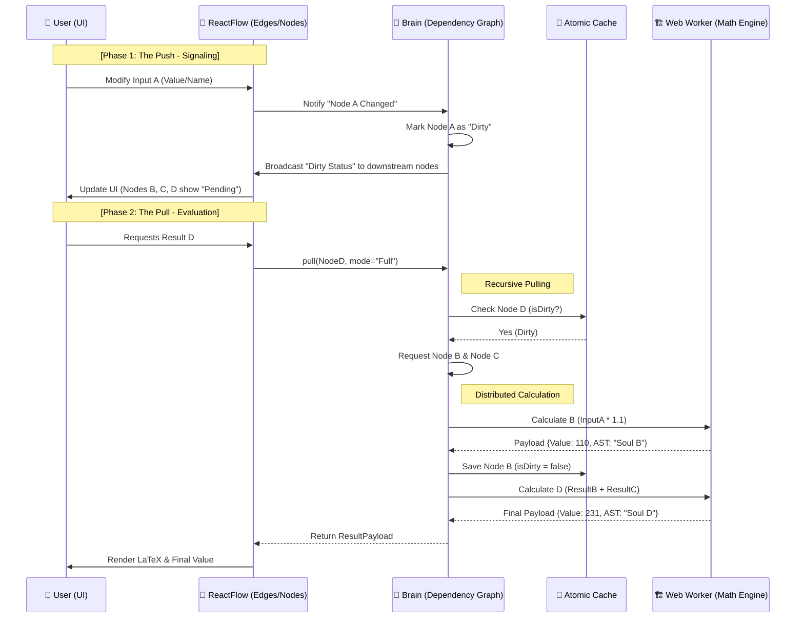

# ⚙️ Calctopus Engine Architecture Discussion

This document tracks the evaluation and final decision for the calculation engine of Calctopus.

## 🏃 Current Candidates

### 1. Push Engine (Eager Evaluation)
- **Concept:** When an input changes, it immediately propagates updates to all downstream nodes.
- **Pros:** 
    - Real-time reactivity is "baked in".
    - Conceptual simplicity (Data flows like water).
- **Cons:** 
    - Performance heavy on large graphs (recalculates everything).
    - Harder to handle complex recursion or cycles without infinite loops.

### 2. Pull Engine (Lazy Evaluation)
- **Concept:** Only calculate a node's value when a "Sink" node (Result/Monitor) requests it.
- **Pros:** 
    - Naturally supports Dead Code Elimination (DCE).
    - Highly efficient for massive graphs.
    - Simplified recursion and cycle detection.
- **Cons:** 
    - Requires a "request signal" to start calculation.
    - Potential latency "pop" on first calculation.

### 3. Hybrid Pull Engine (Push Signal, Pull Data)
- **Concept:** Inputs send a "Dirty" signal downstream (Push). Result nodes, seeing they are dirty, request fresh data (Pull) when needed.
- **Pros:**
    - Combines reactivity with lazy evaluation efficiency.
- **Cons:**
    - Most complex implementation.

---

## 📝 Discussion Log

- **[2026-01-26]**: Initial project rebirth. Decision pending. The goal is a flexible system that handles expert-level complexity.
- **[2026-01-26]**: **Calculation Boundary Decided**. All mathematical and logical calculations happen **Client-Side** via **Web Workers**. Cloud infrastructure (Cloudflare) is strictly for persistent storage and retrieval (D1/Workers), NOT for calculation.

## 🏁 Final Verdict
**Hybrid Pull Engine (Push Signal, Pull Data)**
- **Decision Date:** 2026-02-02
- **Core Principle:** "Push bits (status), Pull bytes (payload)". Use Dirty Signaling for reactivity and Lazy Evaluation for performance.

---

## 🗺️ Master Architecture & Data Flow

---

## 🏗️ 核心規定 (Core Implementation Bible)
這是一套嚴禁違反的開發規則，所有引擎相關的代碼必須符合以下需求。如有衝突，必須優先以此文檔為準。

### 1. 引擎運作機制 (The Law of Flow)
- **Hybrid 優先**：嚴禁使用純 Push。必須使用 `Push Dirty Signal, Pull Payload`。
- **緩存填充律 (Atomic Fulfillment)**：
    - 任何類型的 Pull 請求，節點在計算時必須同時產出並緩存完整的 `NodePayload`（Soul + Body）。
- **數據傳導 (Adaptive Dual-Track Payload)**：線路傳導完整的 `NodePayload`。
    - **魂 (Soul/AST)**：每一級節點負責拼接自身的邏輯結構。**性能優化**：若下游所有的 Result Node 均只請求「Value」，引擎可自動跳過 AST 拼接以節省內存與計算開銷。
    - **分佈式原子計算 (Body/Value)**：每一級節點執行自身數值運算並緩存。下游節點直接引用上游 Value，嚴禁全量公式彙整到終端。

### 2. 計算反饋與性能 (UX & Performance)
- **禁止顯示舊數據**：一旦節點標記為 `Dirty`，UI 應呈現「待更新」或「計算中」狀態。
- **異步隔離**：所有運算必須在 Web Worker 中執行，主線程永不卡頓。

### 3. 持久化與撤銷 (Persistence & Undo)
- **Undo 邊界**：Undo 只記錄用戶的手動操作（修改輸入、重連線路、移動位置、重命名等）。
- **API 數據**：API 返回的動態數據（如實時匯率）不進入 Undo 棧。Undo 操作後，引擎應自動觸發相關鏈路的 `Dirty` 標記，並使用最新的 API 數據重新計算。

---

## 🧬 畫布與引擎的同步律 (UI-Engine Sync Laws)
為了防止「線連上了但代碼沒連上」的災難，必須遵守以下同步規則：

### 1. 唯一事實來源 (Single Source of Truth)
- **視覺事實**：React Flow 的 `edges` 數組是連線的**唯一依據**。
- **邏輯事實**：計算引擎（Brain）必須直接監聽 `edges` 的變化。禁止在引擎內部私自維護與畫布無關的連線邏輯。

### 2. ID 強綁定機制
- **Handle ID**：React Flow 的 Socket (Handle) 必須帶有與 `NodePayload` 對應的 `paramId`。
- **連線映射**：一根線的建立 (`onConnect`) 必須立刻觸發引擎內部的 `Brain.link(sourceId, targetId)` 操作。如果鏈結失敗，畫布必須立刻撤銷該連線。

### 3. 原子性操作
- 禁止「先畫線、後鏈接」。所有的連線操作必須是**原子化**的：即「UI 線路呈現」與「引擎邏輯鏈接」必須在同一個事件循環內完成同步。

### 🛠️ 連線處理生命週期 (Connection Lifecycle)
在開發實現中，必須確保連線遵循以下邏輯順序：

1.  **請求發起**：React Flow 捕獲用戶連線動作，並在畫布生效前將連線參數（來源 ID、目標 ID、接口 ID）發送至引擎驗證層。
2.  **邏輯預檢**：引擎檢查該連線是否會導致非法循環或數據類型衝突。若驗證失敗，則撤回該動作並向用戶報錯，畫布不顯示任何線路。
3.  **依賴註冊**：驗證通過後，引擎在內部的「依賴映射表」中註冊該鏈路。目標節點正式獲得對來源節點結果的「拉取優先權」。
4.  **視覺確認**：邏輯註冊成功後，React Flow 始將該連線數據加入畫布狀態機，完成視覺呈現。
5.  **數據Pull**：當目標節點執行運算時，引擎根據上述註冊關係，自動溯源至來源節點執行 `pull()` 操作，完成數據閉環。

---

## 🧠 Architectural Q&A Archive (Deep Discussion)

### Q: 增加多模式（純數字 vs 公式）是負擔還是幫助？
- **結論：是極大的性能幫助 (The Adaptive Payload Benefit)**。
- **分析**：
    - **負擔面**：引擎需要判斷誰要什麼。但這一層邏輯在 Web Worker 中是極輕量的。
    - **幫助面**：這讓引擎具備了「智能裁減」的能力。如果畫面上只有「純數字」的結果節點，引擎會進入 **「高效能模式」**，完全不分配內存給 AST 字符串。在大規模模擬（如 10,000 次蒙地卡羅）時，這將節省 50% 以上的內存開銷。
- **機制**：引擎在 `Push Signal` 階段標記每個節點的「需求類型」。在 `Pull Data` 階段根據需求選擇性執行「Soul」或「Body」的代碼。
- **定論**：**每一級都要算 (Distributed Atomic Calculation)**。
- **理由**：
    - **效能**：避免終端節點遇到「公式爆炸」需要解析巨型字符串。
    - **穩定性**：每一級節點只需處理最簡單的數值運算（例如一個加法或一個矩陣乘法），這讓系統能輕鬆應對 1,000+ 節點的規模。

### Q: 為什麼不需要 X-ray 功能？
- **用戶決策**：回歸原始節點邏輯，用戶若需偵測中間值，請手動連接 Result 節點。這簡化了 UI 探測層的開發複雜度。

### Q: 不同的 Result Node 請求不同數據，該如何處理？
- **定論**：Pull 請求可以帶 `mode`。但基於「緩存填充律」，無論請求什麼，節點都會計算並緩存「全量 Payload」。

### Q: 應該只傳公式 (Symbolic) 還是只傳數字 (Atomic)？
- **Calctopus 定論**：採用 **雙軌並行 (Dual-Track)**。

---

## 🔮 未來風險預防與邊界處理 (Pre-implementation Audit)
為了防止在 Phase 4-7 需要重構核心，以下是針對未來極限場景的具體預留設計邏輯：

### 1. 循環依賴與疊代節點 (Cycles & Iterators)
- **問題分析**：DAG 引擎最怕死循環。電路模擬或物理運算需要 realtime 循環。
- **預留方案**：
    - **內部循環節點**：引入專門的 `Loop Node`。它內部包含「疊代次數」或「收斂閾值」參數。**封裝性**：`Loop Node` 可以被封裝進 `Group Node` 內部，對外只暴露最終結果。
    - **Real-time 模擬**：通過 `Clock Node` (Input) 解決。它每幀（如 60fps）主動發送一次髒信號。引擎在每一幀執行一次「單向拉取」。這不是「無限死循環」，而是「隨時間步進的線性計算」。

### 2. 封裝節點的「公式化」 (Group-to-Formula)
- **格式選擇**：
    - **LaTeX**：僅用於 UI 顯示與「簡化運算」。缺點是無法 100% 恢復節點（因為丟失了坐標、樣式等元數據）。
    - **JSON Schema (AST+)**：用於節點的「完美還原」。它記錄了節點的位置、屬性與原始鏈路。
- **結論**：封裝節點在內存中以 **JSON Graph** 形式存在以支持「還原」；在計算時編譯為 **MathJS 表達式** 以支持「極速運行」。

### 3. 異步傳輸優化 (Worker Transferables)
- **規定**：Payload 中的 `Body (Value)` 若為大型矩陣或數組，必須支持 **Transferable Objects**。
- **目的**：在主線程與 Web Worker 之間傳遞數據時，使用指針移動而非內存拷貝，確保 Phase 7 的大數據模型下 UI 依然不卡頓。

### 5. 符號求解的「全局升級」 (Symbolic Global Scan)
- **權限升級**：微積分等節點被賦予 **「索取靈魂的權力 (Soul-Pull Permission)」**。
- **運作機制**：引擎從該節點開始反向構建 AST 邏輯樹，收集所有上游節點的「魂 (AST)」，最終拼湊出完整公式丟給符號求解器。
- **預留**：AST 結構必須是標準化的，確保在任何節點都能反向構建完整的邏輯樹。

### 6. 錯誤傳遞機制 (Error Propagation)
- **規定**：當上游節點出現運算錯誤（如除以零、類型不匹配）時，`Body` 必須攜帶 `ErrorCode`，且觸發下游廣播「受損標記」。
- **預留**：下游節點接收到 Error 時，應自動終止計算並同樣進入 Error 狀態，除非該節點具備「錯誤恢復」功能。

### 8. 持久化與「一串數據」還原 (The String Persistence)
- **問題分析**：用戶需要將複雜的畫布轉化為「一串東西」並能完美還原。
- **方案對比**：
    - **❌ 方案 A：純 LaTeX 字符串**
        - **結論**：**不可行**。LaTeX 只能記錄「靈魂（公式）」，會丟失「身體（坐標、樣式、節點 ID、連線拓撲）」。用 $x+y$ 無法還原出兩個 Input Node 的擺放位置。
    - **✅ 方案 B：壓縮 JSON (Logical-Visual Hybrid)**
        - **格式**：包含 `nodes` (ID, 類型, 坐標, 數據) 與 `edges` (來源, 目標, 接口) 的 JSON 對象。
        - **轉化**：使用 `JSON.stringify` 配合 `lz-string` 進行壓縮。
        - **結果**：生成一串類似 `N4Igh...` 的 Base64 字符串。這串東西包含了重建宇宙的所有信息。

### 9. 變量作用域與唯一性 (Variable Scoping)
- **核心守則**：在同一個作用域（畫布或封裝組）內，**禁止重複定義同名變量**。
- **變量去重 (Deduplication - Option B)**：
    - 當從外部（如 LaTeX 或 JSON 導入）導入多個同名變量時，引擎**嚴禁**創建多個重複節點。
    - **正確行為**：僅保留一個 `InputNode` 作為唯一事實來源，並將其輸出鏈路分配給所有依賴該變量的下游節點。
- **偵測機制**：
    1. **實時審計**：當用戶修改 InputNode 的變量名稱（如 `x`）時，引擎會立刻掃描當前作用域的所有節點。
    2. **衝突攔截**：若名稱 `x` 已被佔用，引擎將該節點標記為 `Collision Error` 狀態（UI 報警）。

### 10. 類型安全與自動轉換 (Type Safety & Coercion)
- **核心守則**：引擎必須防止「蘋果連橘子」的無意義計算。
- **自動轉換 (Coercion)**：
    - **標量升級**：當標量（數字）輸入到要求矩陣的端口時，引擎應自動將其視為 $1 \times 1$ 矩陣，不報錯。
- **嚴格驗證 (Strict Validation)**：
    - **維度衝突**：若將大矩陣（如 $3 \times 3$）輸入到僅支持標量的端口，引擎必須於連線階段攔截並報錯。
    - **單位衝突**：若未來引入物理單位，不同單位的加減（如 $1\text{m} + 1\text{kg}$）必須報錯，除非存在合法的轉換比例。

---

## 🚀 Long-term Expansion Plan (The "North Star")

### 1. The "Packaged Logic" Era (Modularity)
- **Concept:** Moving away from a "Flat Canvas" to "Nested Graphs".
- **Vision:** Users can encapsulate complex logic (e.g., an entire Insurance Risk Model) into a single custom node. This prevents "Spaghetti Nodes" and allows for a library of professional calculation "Assets".

### 2. Multi-dimensional & Time-series Data
- **Concept:** Expanding the `NodePayload` to handle more than just matrices.
- **Vision:** Supporting data streams and time-series (e.g., historical fuel prices). The engine must handle arrays that represent values across time, enabling 4D simulations.

### 3. The Symbolic-Numerical Bridge
- **Concept:** AST that can exist without numerical values.
- **Vision:** Integrating Phase 5's symbolic solver so that the engine can simplify math expressions *before* calculating them, or even solve for unknown variables by "back-propagating" the Pull request.
