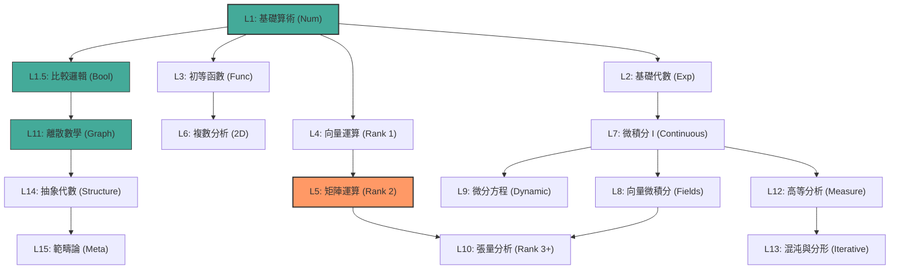

# 📋 數學複雜度 15 級速查表 (Quick Reference)

這張表彙整了從基礎算術到高階理論的全貌，可作為 Calctopus 核心功能的級別參考。

| 等級 | 狀態 | 類別 (Category) | 數據類型 | 迭代策略 (Iter) | 性能 | 潛力 | 限制與解決方案 | 無法完成 (Unsupported) | 節點 | 維度 | 符號 | 核心概念 | 參考庫 | 視覺化 (Vis) | 驗證 (Valid) | 測試 (Test) |
| :--- | :--- | :--- | :--- | :--- | :--- | :--- | :--- | :--- | :--- | :--- | :--- | :--- | :--- | :--- | :--- | :--- |
| **L0** | ✅ | **萬有定義** | Void → Num | Num | 🚀 極快 | 100% | **公理基石**：無需證明。 | 無 (全功能) | NodeInputNumber.tsx | Rank 0 | $\pi, e, \phi$ | 宇宙常數 | MathJS | InputBox | TypeCheck | Unit |
| **L1** | ✅ | **基礎算術** | Num → Num | Scalar | 🚀 極快 | 100% | **精度誤差**：BigNumber。 | 無 (全功能) | NodeMath.tsx | Rank 0 | `+`, `-`, `×`, `÷` | 加減乘除 | Native | NodeBody | TypeNum | Unit |
| **L1.5** | ✅ | **比較邏輯** | Num → Bool | Scalar | 🚀 極快 | 100% | **類型轉換**：布爾轉換。 | 無 (全功能) | NodeCompare.tsx | Rank 0 | `>`, `<`, `≠` | 大小比較 | Native | Toggle/LED | TypeBool | TruthTable |
| **L2** | ✅ | **基礎代數** | Exp → Exp | Symbolic | ⚡ 快 | 100% | **求解範圍**：模塊覆蓋。 | 無 (全功能) | NodeSolver.tsx | Rank 0+ | $x, y, ()$ | 方程求解 | Nerdamer | LaTeXBlock | Syntax | SymTest |
| **L3** | ✅ | **初等函數** | Num → Num | Vector/Map | 🚀 極快 | 100% | **參數類型**：複數域。 | 無 (全功能) | NodeUnary.tsx | 1D Map | $\sin, \log$ | 三角對數 | MathJS | Plot1D | Domain | Property |
| **L4** | ✅ | **向量運算** | Vec → Vec | SIMD | ⚡ 快 | 100% | **維度匹配**：校驗引擎。 | 無 (全功能) | NodeMath.tsx | **Rank 1** | $\vec{v}, \cdot, \times$ | 點積叉積 | MathJS | Arrow3D | DimMatch | GeoTest |
| **L5** | 🚧 | **矩陣運算** | Mat → Mat | Parallel | 🐢 中 | 90% | **UI 渲染**：分頁預覽。 | **GPU 計算** | NodeInputMatrix.tsx | **Rank 2** | $[A], \det$ | 逆矩陣 | MathJS | Heatmap | SquareChk | Property |
| **L6** | ⏳ | **複數分析** | Cplx → Cplx | Vector/Map | ⚡ 快 | 90% | **坐標映射**：2D 視覺化。 | **黎曼曲面** | - | 2D Plane | $i, z, \bar{z}$ | 虛數歐拉 | MathJS | ArgandMap | CplxType | Visual |
| **L7** | ⏳ | **微積分 I** | Exp → Exp | Numeric | 🐢 中 | 70% | **解析解限制**：數值補位。 | **非初等積分** | - | $\Delta \to 0$ | $\frac{d}{dx}, \int$ | 導數積分 | Algebrite | funcPlot | Continuity | NumComp |
| **L8** | ⏳ | **向量微積分** | Field → Vec | Grid Map | 🐢 中 | 60% | **場視覺化**：場指示器。 | **動態流徑** | - | Fields | $\nabla, \oint$ | 梯度散度 | MathJS | VecField | CurlZero | Visual |
| **L9** | ⏳ | **微分方程** | ODE → Exp | Step Loop | 🐌 慢 | 60% | **數值穩定性**：迭代優化。 | **非線性PDE** | - | Dynamic | $y'', \mathcal{L}$ | 拉氏變換 | Nerdamer | PhasePlot | Stability | ExactComp |
| **L10** | ⏳ | **張量分析** | Ten → Ten | GPU | 🔥 極慢 | 40% | **內存與維度**：TF.js。 | **超維縮合** | - | **Rank 3+** | $T^{i}_{j}$ | 張量縮合 | TensorFlow | SliceView | ShapeMatch | GradCheck |
| **L11** | ✅ | **離散數學** | Logic → Bool | Matrix Pow | 🚀 極快 | 100% | **死循環**：拓撲排序。 | 無 (全功能) | NodeLogic.tsx | Graph | $G, \cup, \neg$ | 圖論集合 | Graphlib | NodeLink | Acyclic | Property |
| **L12** | ⏳ | **高等分析** | Set → Num | Symbolic | 🐢 中 | <10% | **抽象度**：符號編譯。 | **實數完備** | - | Measure | $\epsilon, \delta$ | 測度論 | - | TextProof | AxiomChk | Automated |
| **L13** | ⏳ | **混沌分形** | Iter → Image | GPU Shader | 🔥 極慢 | 30% | **迭代算力**：WebWorker。 | **無限精度** | - | Fractal | $\zeta, \mathcal{M}$ | 迭代函數 | custom | ZoomPan | BoundChk | Visual |
| **L14** | ⏳ | **抽象代數** | Group → Map | Abstract | 🐢 中 | <10% | **非數值**：定義接口。 | **群同構** | - | Structure | $G/H, \ker$ | 同態、環 | - | CayleyTbl | GroupChk | Property |
| **L15** | ⏳ | **範疇論** | Meta → Map | Recursive | 🔥 極慢 | <5% | **元編程**：映射組合。 | **公理推導** | - | Meta | $F, \eta$ | 函子 | - | Diagram | TypeChk | TypeCheck |

---

## 🗺️ 等級依賴與進化圖 (Dependency Diagram)

---

---

## 🚧 複雜度障礙與突破 (Complexity Barriers)

當你感覺到「微積分就是極限」時，這其實是非常準確的直覺。在數學史上與應用中，這裡存在三個主要的「門檻」：

### 1. 「視覺化」的障礙 (L7 - L9)
*   **牆壁**：微積分描述的是連續的變化與曲線。人類的肉眼可以輕易理解 L7 的切線、L8 的梯度。
*   **極限**：一旦進入 L10 (張量)，空間開始扭曲且維度超過 3D，傳統的「圖像直覺」就會失效。這是為什麼許多計算機到這裡就停止了。

### 2. 「連線」的優勢：跨越 L11 (離散數學)
*   **驚喜**：對於 Calctopus 這種 **「節點導向 (Node-based)」** 的工具，L11 (離散數學/圖論) 反而是**最容易實現**的。
*   **原因**：因為 Calctopus 本身就是一個「圖 (Graph)」。你畫的每一條線、每一個節點，本質上就是在進行 L11 的運算。這讓 Calctopus 比傳統數字計算機更適合處理現代演算法。

### 3. 「AI」的橋樑：突破 L10 (張量)
*   **未來**：如果你想讓 Calctopus 支持人工智慧、神經網絡，L10 就是必經之路。
*   **方向**：將矩陣 (Rank 2) 擴展到高階多維陣列。Node-based UI 非常適合展示神經網絡的層級（這正是 TensorFlow/PyTorch 的核心邏輯）。

---

### 💡 關鍵定義提醒
*   **Rank (階秩)**：標量 = 0，向量 = 1，矩陣 = 2，張量 = 3+。
*   **L5 (矩陣)**：這是 Calctopus 目前正在攀爬的「專業門檻」。
*   **L7 - L9** | **L10 - L11**：分別是古典工程學的極限與現代 AI 的起點。

---

## 📖 術語辨析 (Terminology Guide)
為何我們將 **L0** 稱為「萬有定義 (Universal Definitions)」而非單純的「公理」或「常數」？

1.  **公理 (Axiom)**：
    *   **定義**：邏輯推導的**起點規則**，不證自明。
    *   **例子**：「兩點可連成一直線」、「$a + b = b + a$ (交換律)」。
    *   **位置**：主要出現在 **L1 (算術公理)** 與 **L11 (邏輯公理)**。

2.  **定義 (Definition) / 常數 (Constant)**：
    *   **定義**：對一個特定值的**命名**或**描述**。
    *   **例子**：「$\pi$ 是圓周長與直徑的比值」。我們不能「證明」$\pi$，我們只能「定義」它並計算其數值。
    *   **位置**：**L0**。這些是我們系統預設存在的數值，相當於程式語言中的 `Const`。

3.  **定理 (Theorem)**：
    *   **定義**：從公理與定義出發，經過邏輯推導證實的**結論**。
    *   **例子**：「畢氏定理 ($a^2 + b^2 = c^2$)」、「歐拉公式 ($e^{ix} = \cos x + i \sin x$)」。
    *   **位置**：**L2 - L15** 的大部分公式與推導結果。

**結論**：在 Calctopus 中，L0 的 $\pi, e$ 扮演著**數值上的公理 (Numerical Axioms)** 角色——它們是我們計算的不可質疑的起點。

---

## 🛠️ 維護手冊 (Maintenance Guide)
為了確保這張表反映了 `ROADMAP.md` 的真實執行進度，請遵循以下步驟：

1.  **狀態更新**：當 Phase 完成後，手動將對應等級從 🚧 或 ⏳ 更新為 ✅。
2.  **源碼跳轉**：將新增的節點文件（位於 [src/components/nodes/](file:///d:/Antigravity/Calctopus/src/components/nodes/)）鏈接到「對應節點」列。
3.  **同步檢查**：每月檢查一次層級定義，確保 Calctopus 的 AST 解析（Phase 11）涵蓋了對應等級的符號。
