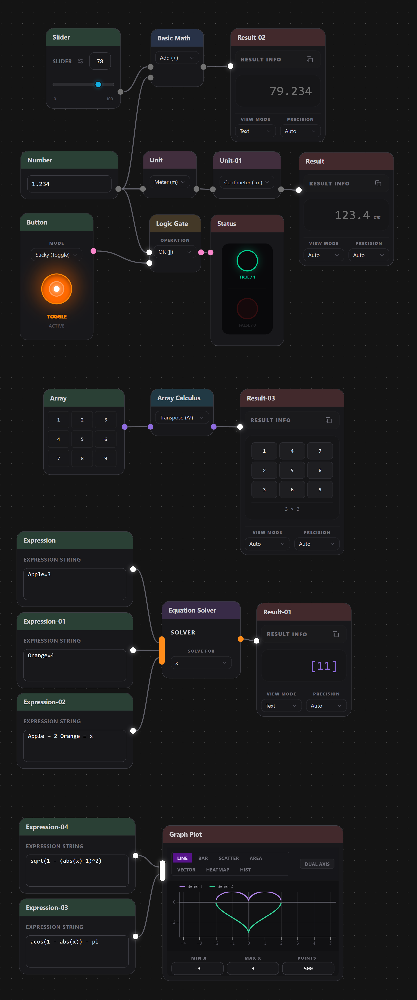

#  input-output

[](https://www.gnu.org/licenses/gpl-3.0)
[](https://github.com/xhang1108/input-output)
[](https://ko-fi.com/nobaggage2rome)
[](https://www.nobaggage2rome.com)

**A free, node-based calculator that visualizes the calculation process. Build and connect your logic.**

### [www.input-output.cc](https://www.input-output.cc)
Some scummy domain registrars snatched the domain I wanted. I urge everyone to stop searching on those dirt-cheap domain sites.



## Core Capabilities

- **Unified Engine**: Single interface for `mathjs`, `nerdamer`, `vega-lite`, and `elkjs`.
- **IOGL 1.0 Protocol**: JSON-based text format for deterministic graph serialization and IOGL-tool validation.
- **Symbolic Solver**: Integrated `nerdamer` for advanced calculus and symbolic solutions.
- **LaTeX-to-Graph**: Robust formula import via MathJS AST engine for 100% topological accuracy.
- **Dynamic Plotting**: High-performance visualization using `Vega-Lite`.

## Dependencies

| Module | Libraries Used |
| :--- | :--- |
| **Logic & UI** | `React 19`, `Next.js 16`, `Tailwind CSS 4`, `Framer Motion` |
| **Graph Engine** | `@xyflow/react`, `Elk.js` |
| **Math & Symbols** | `MathJS`, `Nerdamer`, `KaTeX` |
| **Data Viz** | `Vega`, `Vega-Lite`, `React-Vega` |
| **State & Sync** | `Zustand`, `LZ‑String`, `Nanoid` |
| **Infrastructure** | `Drizzle ORM`, `Next-Auth`, `Radix UI` |

## Getting Started

### Installation
```bash
npm install
```

### Development
```bash
npm run dev
```
Open [http://localhost:3000](http://localhost:3000) to access the local environment.

### Quality Control
```bash
npm run test       # Continuous testing
npm run test:run   # Package script
npx vitest run     # Direct test runner (Single pass)
```

### Security & Vulnerability Reporting

If you discover any security vulnerabilities, large or small, please feel free to report them by [opening a GitHub Issue](https://github.com/xhang1108/input-output/issues) or contacting the maintainer directly at:

**[contact@nobaggage2rome.com](mailto:contact@nobaggage2rome.com)**

Built by the **NoBaggage2Rome** Team.
[www.nobaggage2rome.com](https://www.nobaggage2rome.com)
© 2026. All rights reserved.
