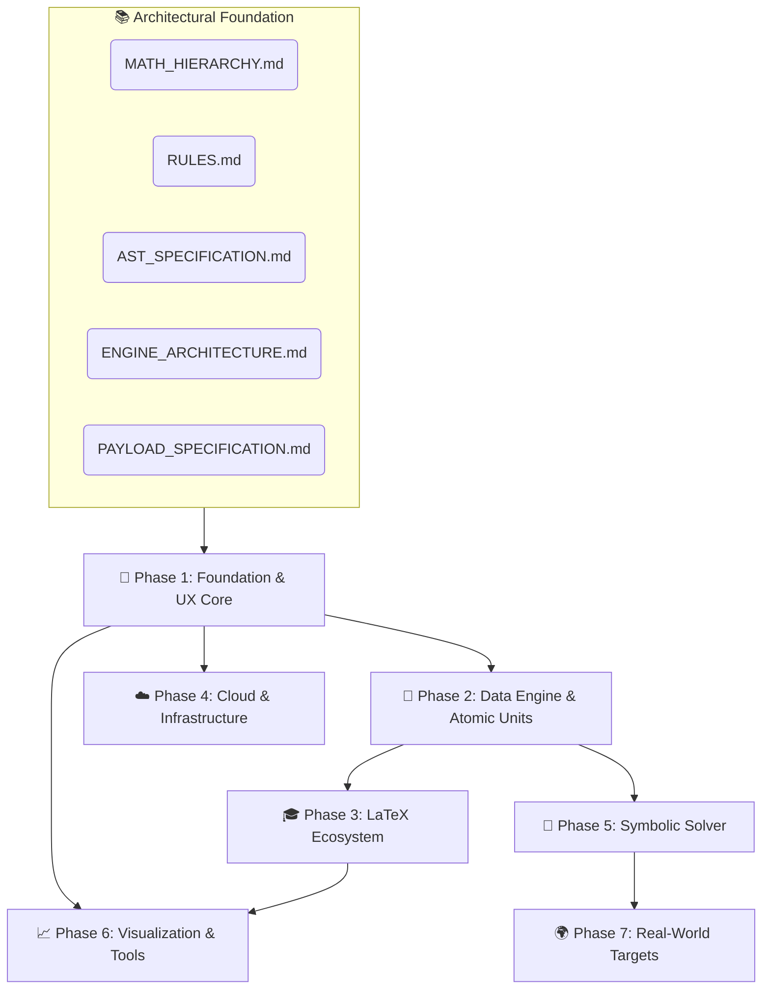

# 🗺️ Calctopus Roadmap (System Rebirth - 7-Phase Model)

> **Mission:** Build a flexible system that can be simple for beginners but highly complex for experts using Blender-style node workflow, strict atomic design, and vectorization-first computation.

## 🛤️ Execution Flow & Dependencies

> [!TIP]
> **[MATH_HIERARCHY.md](file:///d:/Antigravity/Calctopus/MATH_HIERARCHY.md)**: 15-Level Math Complexity Guide  
> **[UTILITY_NODES.md](file:///d:/Antigravity/Calctopus/UTILITY_NODES.md)**: Helper Nodes Specification  
> **[RULES.md](file:///d:/Antigravity/Calctopus/.agent/RULES.md)**: Architectural Constraints  
> 
> **討論文檔 (架構核心)：**  
> • **[AST_SPECIFICATION.md](file:///d:/Antigravity/Calctopus/AST_SPECIFICATION.md)**: 內部 AST 結構 (骨骼)  
> • **[ENGINE_ARCHITECTURE.md](file:///d:/Antigravity/Calctopus/ENGINE_ARCHITECTURE.md)**: 推/拉引擎架構 (心臟)  
> • **[PAYLOAD_SPECIFICATION.md](file:///d:/Antigravity/Calctopus/PAYLOAD_SPECIFICATION.md)**: 數據包結構規範 (血液)

---

## 🛑 Phase 1: Foundation, Engineering & UX Core
**Goal:** Establish architecture, engine, and permanent interaction logic.

- [ ] **Strategic Realignment & Rules**
    - [ ] Defined goal: [Flexible System].
    - [ ] Enforce **[RULES.md](file:///d:/Antigravity/Calctopus/.agent/RULES.md)**: No Stealth Coding, Atomic Units.
    - [ ] **[SKILL_ATOMIC_DESIGN.md](file:///d:/Antigravity/Calctopus/SKILL_ATOMIC_DESIGN.md)**: Design methodology.
- [ ] **Core Architecture Implementation**
    - [ ] Next.js 14+ / React Flow Integration.
    - [ ] **Separation of Concerns:** `Brain.ts` (Pure Logic) vs `Body.tsx` (React Render).
    - [ ] **Nerves System:** Custom hooks (`useBrain`, `useHand`, `useEar`) for event handling.
- [ ] **Engine Implementation (The "Brain")**
    - [ ] **Core Engine Logic**: Implement the Hybrid Pull model (**Selective Processing**) as defined in the **[ENGINE_ARCHITECTURE.md Bible](file:///d:/Antigravity/Calctopus/ENGINE_ARCHITECTURE.md)**.
    - [ ] **Web Worker Orchestration**: Setup background worker for math execution using **Shared/Pooled Workers**.
    - [ ] **Payload Architecture**: Implement `NodePayload` (Soul & Body) with **Scale-Agnostic Unified Logic**.
    - [ ] **Variable Registry**: Implement **Reference Counting GC** and **Option B Deduplication**.
    - [ ] **Performance & UX**: Implement **Fusion-style progress** (NodeResolved) and **Transferables**.
    - [ ] **Throttle & Control**: Implementation of manual Auto/Pause/Play modes for high-load state management.
- [ ] **Testing & Telemetry**
    - [ ] **Unit**: `vitest` for graph topologies (Cyclic, Disconnected, Type Errors).
    - [ ] **E2E**: Browser-based tests utilizing Chrome DevTools Protocol (MDP) for UI interaction.
    - [ ] **Telemetry (Future)**: Record execution metrics and performance logs in background.
- [ ] **Atomic Logic Nodes**
    - [ ] **Note:** Expanded based on **[MATH_HIERARCHY.md](file:///d:/Antigravity/Calctopus/MATH_HIERARCHY.md)** levels.
    - [ ] **Comparison Ops:** `>`, `<`, `=`, `!=`, `>=`, `<=`.
    - [ ] **Control Flow:** `NodeSwitch.tsx` (If/Else logic) with lazy branch pulling.
- [ ] **History & Persistence**
    - [ ] **Undo Scheme B**: Command Pattern (Action-based). Records discrete edits, moves, and links.
    - [ ] **Boundary**: Canvas Navigation (Zoom/Pan) is NOT recorded.
    - [ ] **Storage**: LocalSync via `localStorage` with 30s Auto-Save.
    - [ ] **Persistence Rules**: **No Stale Cache**. Recalculate on load for accuracy.
- [ ] **Interaction Model (Permanent Logic)**
    - [ ] **Sticky Placement:** `Shift+D` for spawn-in-place + relative movement.
    - [ ] **Standard Paste:** `Ctrl+V` (mouse-centered).
    - [ ] **Blender Detachment:** `onReconnect` logic for dragging input edges.
    - [ ] **Copy-Paste with Edges:** Connected edges are preserved in multi-selection.
- [ ] **Visual Validation**
    - [ ] **Socket Geometry:** Shapes are **Pending Discussion**. 
    - [ ] **Layer 1: Repel**: Prevent incompatible connections from snapping.
    - [ ] **Layer 2: Color Feedback**: Use Blender-style **colors** (Wires/Sockets) to represent data types (No line thickness variants).
    - [ ] **Multiple Outputs**: Use separate handles (Blender Style).
- [ ] **Custom Edge Architecture**
    - [ ] **Custom Component**: Replace default React Flow edges with fully custom logic to bypass limitation.
    - [ ] **Smart Styling**: Styles (stroke, animation) driven dynamically by `EdgePayload` (Error, Active, Type).
    - [ ] **Interactions**: Context menus on edges, double-click to add Reroute nodes.
- [ ] **Layout & Navigation**
    - [ ] **Zoom Behavior:** **Zoom to Mouse** (centered on cursor).
    - [ ] **Minimap:** Custom node colors support.
    - [ ] **Layout Engine:** Integrated `elkjs` for automated layered layout.

---

## 🧮 Phase 2: Data Engine & Smart Units
**Goal:** A high-performance numerical core that understands physical units.

- [ ] **Math Libraries Integration**
    - [ ] **Nerdamer**: Equation solving (single & systems).
    - [ ] **Algebrite**: Advanced symbolic ops (factoring, calculus).
    - [ ] **MathJS**: Numerical computation, matrix ops, unit conversion.
- [ ] **Math Router & Performance**
    - [ ] **Lazy Loading**: Convert imports to dynamic imports with loading states.
    - [ ] **Math Router**: Create manager for routing tasks to the best library.
- [ ] **Atomic Units System**
    - [ ] **Unit Node**: Dropdown with units provided by math libraries (km, l, kg, etc.).
    - [ ] **Behavior**: Connect after an Input node to tag data with units.
    - [ ] **Symbol Propagation**: Outgoing data carries the unit symbol through the graph.
    - [ ] **Smart Automation**: Math nodes handle unit conversions (`km + m = 5.003km`) natively via MathJS.
    - [ ] **Atomic Rule**: Specialized units (e.g., `100km/l`) are assembled by users.
- [ ] **Conversion & Constants**
    - [ ] **Unit Conversion**: Support for mixed units (e.g., `5ft + 2in`) and validation.
    - [ ] **Physics Constants**: pi, e, G, c, h. Searchable sidebar/dropdown.
- [ ] **Philosophy: No Magic Units**
    - [ ] **Zero Overhead**: Pure numbers remain scalars.
    - [ ] **No Hidden Math**: Compound units (e.g., `L/100km`) must be built explicitly from atoms.
- [ ] **Matrix Support**
    - [ ] **Engine Integration**: Switch internal ops to `math.add(a, b)` for matrix support.
    - [ ] **Operators**: Add `transpose`, `det`, `inv`, `tr`, and element-wise `.*`.
    - [ ] **UI Visualization**: Render matrices as HTML tables (already highly refined).
    - [ ] **Dimension Badges**: Display matrix size (e.g., `[5x5]`) on wires.

---

## 🎓 Phase 3: LaTeX Unified Ecosystem
**Goal:** Make LaTeX the "Soul" of the system without performance cost.

- [ ] **LaTeX Logic & Parser (The Formula Bridge)**
    - [ ] **LaTeX-to-Node**: Generate a visual subgraph from a LaTeX string.
        - [ ] **Symbolic Parsing & AST Mapping**: Use `tex-math-parser` to map operators to atomic nodes.
        - [ ] **Automatic Deduplication (Option B)**: Ensure identical variables in the formula point to a single `InputNode`.
    - [ ] **Node-to-LaTeX**: Compile groups/subgraphs into optimized LaTeX strings.
    - [ ] **Group-as-LaTeX Performance**: Evaluate the compiled single formula instead of individual internal nodes to save performance.
    - [ ] **Symbolic Propagation**: Wires carry LaTeX expressions as metadata.
- [ ] **Expert Node (NodeExpression)**
    - [ ] A dedicated node for writing raw LaTeX code (e.g., `\det([1,2;3,4]) * sin(x)`).
    - [ ] **Hybrid IO**: Auto-generate ports based on detected variables.
    - [ ] **Note**: No "Expert Mode" UI—just a powerful node for advanced users.

---

## ☁️ Phase 4: Cloud & Infrastructure
**Goal:** Secure storage and seamless sharing.

- [ ] **Serialization**
    - [ ] LaTeX-based persistence format + `lz-string` URL compression.
- [ ] **Cloudflare Strategy**
    - [ ] **Data Repository**: Cloudflare D1 (SQLite) as the primary store for user graphs.
    - [ ] **Role**: Cloudflare is strictly for **Storage & Retrieval**. No calculation happens on the edge/server.
    - [ ] **Auth**: Google OAuth 2.0 integration (NextAuth/Supabase).
    - [ ] **Profile**: Fetch user avatar and name for the UI header.
    - [ ] **Sharing**: Public read-only links for sharing calculations.

---

## 🔮 Phase 5: Symbolic Solver & Simulation
**Goal:** Advanced computational logic and time-based progression.

- [ ] **Omni-directional Solver**
    - [ ] **Constraint Solver**: Ports adapt based on data flow (Solve for X).
    - [ ] **Multi-equation Systems**: Support simultaneous equations with multiple unknowns.
- [ ] **Symbolic Data Flow**
    - [ ] **Expression Propagation**: Wires carry symbolic expressions (e.g., `Expression("sin(x^2)")`).
    - [ ] **Step-by-Step Proofs**: Visualize formula transformation through the graph.
- [ ] **Simulation Zones**
    - [ ] **Concept**: `Result(Frame t)` fed into `Input(Frame t+1)`.
    - [ ] **Optimization**: High-performance Vectorization (Array Ops) for iterative calculations.

---

## 📈 Phase 6: Visualizations & Tools
**Goal:** Introspection and graphical representation.

- [ ] **Unified Expert View**
    - [ ] **Expert Interface**: Expert nodes (LaTeX, Script) live alongside visual nodes.
- [ ] **Introspection & Debugging**
    - [ ] **Live Debugger (X-Ray)**: Inspect symbolic strings and cached values at any point on a wire.
    - [ ] **NodeLabel/Template**: Custom naming and human-readable string composition for nodes.
- [ ] **Graphical Output & Shells**
    - [ ] **Plotting Node**: 2D/3D Plotly.js/Recharts dynamic charts following atomic rules.
    - [ ] **Structural Shells (Box UI)**: A wire-free, slot-based interface interchangeable with nodes.
    - [ ] **Triple-Sync**: LaTeX <-> Nodes <-> Box UI.

---

## 🌍 Phase 7: Vision & Goal Targets
**Goal:** Use-cases to guide developmental focus (No implementation needed; guidance only).

- [ ] **Targets**:
    - Gas station cost-benefit analysis.
    - Insurance risk and Expected Value modeling.
    - Cross-border price arbitrage logic.

---

## 📱 Phase 8: Cross-Platform Architecture Preparation
**Goal:** Design for portability—enable future migration to desktop and mobile platforms.

> [!IMPORTANT]
> **核心原則：引擎與 UI 完全分離，確保計算邏輯可在任何平台複用。**

- [ ] **Platform-Agnostic Engine Core**
    - [ ] Ensure `Brain.ts` has **zero dependencies** on React, DOM, or browser APIs.
    - [ ] Abstract interfaces for future portability:
        - `IComputeExecutor` — Computation layer (Web Worker / Native Thread).
        - `ICanvasAdapter` — Canvas rendering (React Flow / Flutter Canvas).
        - `IPersistence` — Storage (localStorage / File System / SQLite).
    - [ ] Consider future Rust rewrite for performance-critical paths (compile to WASM for Web, native for mobile).

- [ ] **Target Platforms & Technology Stack**

    | Platform | Technology | Reuse Level | Notes |
    |----------|------------|-------------|-------|
    | **Web** | Next.js + React Flow | 100% | Current implementation |
    | **Desktop** | Tauri (Rust backend) | ~95% | Reuse React Flow UI, native system APIs |
    | **Mobile** | Flutter (Dart + Skia) | Engine only | UI requires rewrite in Dart |

- [ ] **Why Flutter for Mobile (Not Electron/React Native)**
    - **True Native Rendering**: Skia/Impeller GPU engine, not a browser wrapper.
    - **AOT Compilation**: Dart compiles to native machine code, not interpreted.
    - **Performance**: Stable 60/120 fps, low memory footprint.
    - **Cross-platform**: Single codebase for iOS + Android + Desktop.

- [ ] **Migration Path**
    1. **Phase 1 (Current)**: Web-first with clean engine separation.
    2. **Phase 2 (Desktop)**: Wrap with Tauri for Windows/macOS/Linux (~minimal effort).
    3. **Phase 3 (Mobile)**: Rewrite UI in Flutter, reuse engine via Rust FFI or WASM.

- [ ] **Long-term Vision (TBD)**:
    - **Multi-dimensional & Time-series Data**: 擴展 `NodePayload` 以支持時間序列數據，實現金融回測與模擬功能。
